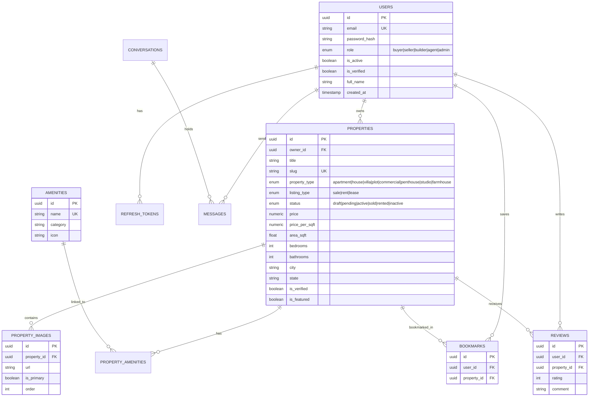

# Database Schema & Architecture Documentation — PropVerse AI

## 1. Entity Relationship (ER) Diagram

## 2. Core Database Tables & Descriptions

### `users`
Stores user accounts for buyers, sellers, builders, agents, and admins.
* `id`: UUID (Primary Key)
* `email`: VARCHAR(320) Unique Index
* `role`: Enum (`buyer`, `seller`, `builder`, `agent`, `admin`)
* `is_verified`: BOOLEAN (Email verification state)

### `properties`
Primary catalog of real estate listings.
* `id`: UUID (Primary Key)
* `owner_id`: UUID (FK to `users.id`)
* `price`: NUMERIC(15, 2)
* `city`, `state`: Indexed location attributes for fast search filtering
* `status`: Enum (`active`, `pending`, `sold`, etc.)

### `property_images`
Media assets for each property listing.
* `is_primary`: Main photo thumbnail flag

### `amenities` & `property_amenities`
Normalized amenity matrix (Swimming Pool, Gym, CCTV, Power Backup, etc.).

### `conversations` & `messages`
Real-time chat persistence storing sender IDs, timestamps, and message content.
